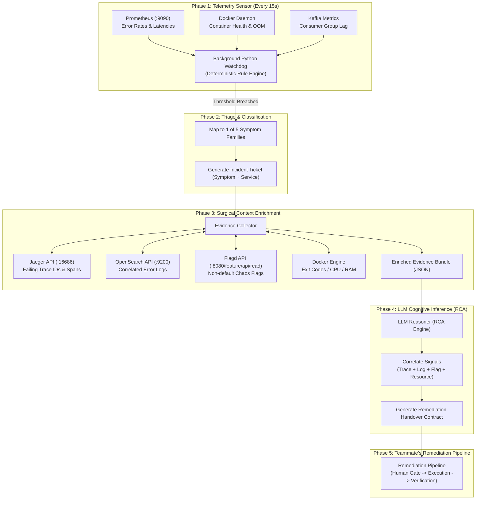

# Autonomous On-Call AI Engineer: Detection & RCA Pipeline Specification

> **Target System:** OpenTelemetry Astronomy Shop Demo  
> **Scope:** Incident Detection, Telemetry Ingestion, Evidence Correlation, Root Cause Analysis (RCA), and Remediation Handover Contract.

---

## 1. System Overview & End-to-End Pipeline

This pipeline monitors all microservices and infrastructure components without streaming raw data into the LLM. It operates on a **Watchdog-to-Agent (Trigger & Triage)** architecture:



---

## 2. Phase 1 & 2: Detection & Symptom Classification

Instead of writing 24 individual monitoring scripts, all 24 possible failure scenarios in the demo collapse into **5 Universal Symptom Families**.

### The 5 Symptom Classifications

| Symptom Code | Trigger Condition / Query | Sample Causes Detected |
| :--- | :--- | :--- |
| **`HIGH_ERROR_RATE`** | `sum(rate(http_requests_total{status=~"5.."}[1m])) / sum(rate(http_requests_total[1m])) * 100 > 15%` | `paymentFailure`, `paymentUnreachable`, `cartFailure`, `productCatalogFailure`, `adFailure`, `recommendationCacheFailure` |
| **`HIGH_LATENCY`** | `histogram_quantile(0.95, sum(rate(http_request_duration_seconds_bucket[1m])) by (le, service_name)) > 3.0` | `intlShippingSlowdown`, `imageSlowLoad`, `adHighCpu`, `adManualGc` (GC pauses), `productCatalogLockContention`, `aiSlowResponse` |
| **`CONTAINER_DOWN`** | `container.status != "running"` OR `up{job="<service>"} == 0` | Container crash/panic, `astronomy-db` down, `valkey-cart` down, `failedReadinessProbe` |
| **`RESOURCE_SPIKE`** | `container_memory_usage_bytes / limit > 0.85` OR `cpu_usage > 0.95` | `emailMemoryLeak` (caught prior to OOM kill), `adHighCpu`, CPU starvation |
| **`PIPELINE_QUEUE_LAG`** | `kafka_consumergroup_lag > 50` OR `token_usage_rate > threshold` | `kafkaConsumerDead`, `kafkaQueueProblems`, `aiRunawayAgent` (recursion limit) |

### Watchdog Code Implementation

```python
import time
import requests
import docker

PROMETHEUS_URL = "http://localhost:9090"
FLAGD_URL = "http://localhost:8080/feature/api/read"
docker_client = docker.from_env()

def run_watchdog():
    """Lightweight loop executed every 15 seconds."""
    # 1. Check Error Rates
    q_err = 'sum by (service_name) (rate(http_requests_total{status=~"5.."}[1m])) / sum by (service_name) (rate(http_requests_total[1m])) * 100'
    res = requests.get(f"{PROMETHEUS_URL}/api/v1/query", params={"query": q_err}).json().get("data", {}).get("result", [])
    for item in res:
        rate = float(item["value"][1])
        if rate > 15.0:
            return {
                "symptom": "HIGH_ERROR_RATE",
                "service": item["metric"].get("service_name", "unknown"),
                "value": f"{rate:.1f}% error rate",
                "timestamp": time.time()
            }

    # 2. Check Latency Spikes (p95 > 3s)
    q_lat = 'histogram_quantile(0.95, sum(rate(http_request_duration_seconds_bucket[1m])) by (le, service_name))'
    res = requests.get(f"{PROMETHEUS_URL}/api/v1/query", params={"query": q_lat}).json().get("data", {}).get("result", [])
    for item in res:
        lat = float(item["value"][1])
        if lat > 3.0:
            return {
                "symptom": "HIGH_LATENCY",
                "service": item["metric"].get("service_name", "unknown"),
                "value": f"{lat:.2f}s latency",
                "timestamp": time.time()
            }

    # 3. Check Container Health
    for c in docker_client.containers.list(all=True):
        if "opentelemetry-demo" in c.name and c.status not in ["running", "healthy"]:
            return {
                "symptom": "CONTAINER_DOWN",
                "service": c.name,
                "value": f"Container status: {c.status}",
                "timestamp": time.time()
            }

    return None
```

---

## 3. Phase 3: Surgical Context Enrichment Engine

Once the watchdog identifies a symptom (e.g., `HIGH_ERROR_RATE` on `checkout`), it queries the other backends to build an **Evidence Bundle**.

```python
def enrich_incident_context(symptom_event):
    service = symptom_event["service"]
    evidence = {
        "incident_id": f"INC-{int(time.time())}",
        "symptom": symptom_event["symptom"],
        "service": service,
        "metrics_summary": symptom_event["value"],
        "traces": [],
        "logs": [],
        "active_chaos_flags": {},
        "container_details": {}
    }

    # 1. Fetch Failing Traces from Jaeger
    try:
        j_resp = requests.get(
            "http://localhost:16686/api/traces",
            params={"service": service, "tags": '{"error":"true"}', "limit": 2}
        ).json()
        for trace in j_resp.get("data", []):
            trace_id = trace["traceID"]
            # Find the exact span with error=true
            error_spans = [s["operationName"] for s in trace["spans"] 
                           for tag in s.get("tags", []) if tag["key"] == "error" and tag["value"] is True]
            evidence["traces"].append({"trace_id": trace_id, "error_spans": error_spans})
    except Exception as e:
        evidence["traces"].append(f"Trace fetch error: {e}")

    # 2. Fetch Correlated Logs from OpenSearch
    try:
        query_body = {
            "query": {
                "bool": {
                    "must": [
                        {"match": {"service.name": service}},
                        {"match": {"severity_text": "ERROR"}}
                    ]
                }
            },
            "size": 3,
            "sort": [{"@timestamp": {"order": "desc"}}]
        }
        os_resp = requests.post("http://localhost:9200/_search", json=query_body).json()
        for hit in os_resp.get("hits", {}).get("hits", []):
            evidence["logs"].append(hit["_source"].get("body", ""))
    except Exception:
        pass

    # 3. Check Active Chaos Flags from Flagd
    try:
        flags_resp = requests.get("http://localhost:8080/feature/api/read").json()
        for name, data in flags_resp.get("flags", {}).items():
            current_variant = data.get("defaultVariant", "off")
            if current_variant != "off":
                evidence["active_chaos_flags"][name] = current_variant
    except Exception:
        pass

    return evidence
```

---

## 4. Phase 4: Cognitive RCA & Diagnostic Inference

The enriched evidence bundle is fed to the LLM with a structured system prompt.

### Prompt Template for the LLM

```text
You are an expert Site Reliability Engineer (SRE).
Analyze the following telemetry incident evidence bundle and perform Root Cause Analysis (RCA).

EVIDENCE BUNDLE:
{evidence_bundle_json}

KNOWLEDGE BASE (Known Demo Faults):
- paymentFailure: Fails PaymentService/Charge when active.
- paymentUnreachable: Payment endpoint down.
- cartFailure: CartService throws exceptions.
- productCatalogFailure: Fails only when product_id == 'OLJCESPC7Z'.
- emailMemoryLeak: Ruby email service memory expands until OOM.
- adHighCpu / adManualGc: Ad service CPU spikes / latency jumps.
- kafkaConsumerDead / kafkaQueueProblems: Consumer lag grows.
- Container Down: Infrastructure service stopped.

TASK:
1. Identify the exact root cause.
2. Correlate evidence across Trace, Metric, Log, and Flag/Container state.
3. Generate the Remediation Handover Contract in valid JSON.
```

---

## 5. Phase 5: Remediation Handover Contract (Interface for Teammate)

To cleanly hand over the output to your teammate's remediation pipeline, the LLM outputs a standardized **Handover Contract (JSON)**:

```json
{
  "incident_id": "INC-1729676600",
  "status": "AWAITING_APPROVAL",
  "timestamp": "2026-10-23T15:05:00Z",
  "diagnosis": {
    "culprit_service": "payment",
    "root_cause": "Chaos flag 'paymentFailure' is active with variant '100%', causing all card authorization requests to abort with status code Internal.",
    "blast_radius": "Checkout service is 100% blocked for all purchasing users.",
    "evidence": {
      "metric": "Checkout 5xx error rate is 96.4%",
      "failing_trace_id": "3e9b14c995f2a1b0",
      "failing_span": "PaymentService/Charge",
      "error_log": "Payment request failed. Invalid token. demo.user_context.loyalty_level=gold",
      "active_flag": {
        "flag_name": "paymentFailure",
        "current_variant": "100%"
      }
    }
  },
  "remediation_plan": {
    "summary": "Reset paymentFailure flag to 'off' and verify checkout error rate recovers.",
    "actions": [
      {
        "step": 1,
        "action_type": "TOGGLE_FLAG",
        "target": "paymentFailure",
        "parameters": {
          "desired_variant": "off",
          "api_endpoint": "http://localhost:8080/feature/api/write"
        },
        "description": "Send POST request to Flagd API setting defaultVariant to 'off'."
      },
      {
        "step": 2,
        "action_type": "VERIFY_RECOVERY",
        "target": "checkout",
        "parameters": {
          "metric_query": "sum(rate(http_requests_total{status=~'5..'}[1m]))",
          "expected_value": 0,
          "evaluation_window_seconds": 30
        },
        "description": "Confirm checkout error rate returns to 0% in Prometheus."
      }
    ]
  }
}
```

---

## 6. Supported Action Types in the Handover Contract

Your teammate's remediation executor only needs to handle 3 `action_type` values:

1. **`TOGGLE_FLAG`**:
   - **Payload:** `{"flag_name": "<name>", "desired_variant": "off"}`
   - **Execution:** Calls `POST http://localhost:8080/feature/api/write`.
   - **Solves:** 19 of the 24 demo failures.

2. **`RESTART_CONTAINER`**:
   - **Payload:** `{"container_name": "<service>"}`
   - **Execution:** Calls Docker Engine API (`/containers/<id>/restart`).
   - **Solves:** Memory leaks (`email`), deadlocks, or unresponsive containers.

3. **`START_CONTAINER`**:
   - **Payload:** `{"container_name": "<service>"}`
   - **Execution:** Calls Docker Engine API (`/containers/<id>/start`).
   - **Solves:** Stopped databases or caches (`valkey-cart`, `astronomy-db`).
